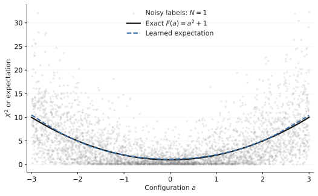
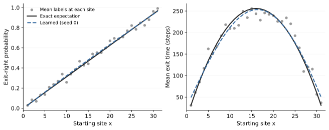

## Convergence is expensive

Consider a family of expectations indexed by a configuration $a$:

$$
F(a)=\mathbb E_{\xi\sim p(\cdot\mid a)}[f(a,\xi)].
$$

For one configuration, the usual Monte Carlo (MC) estimator is

$$
\hat F_N(a)=\frac{1}{N}\sum_{i=1}^{N}f(a,\xi_i),
\qquad \xi_i\overset{\mathrm{iid}}\sim p(\cdot\mid a).
$$

With finite variance, the estimator's root-mean-squared error decreases as $N^{-1/2}$. Resolving each expectation independently can therefore be expensive.

To learn a surrogate $G_\theta(a)$ across material properties, source distributions, or model parameters, a fixed budget can buy accurate labels at a few configurations or noisy labels at many.

**Must each Monte Carlo estimate converge before it becomes useful training data?**

For squared-error regression, conditionally unbiased labels preserve the clean population optimum, even when individual estimates are poor. Learning can pool evidence across configurations when their expectation map has shared structure.

Motivated by noisy particle-transport supervision in PTNO [@cao2026ptno], we examine this equivalence, simulation allocation, and nonlinear target bias.

## Learning from an unconverged estimator

Write the stochastic label as

$$
\hat F_N(a)=F(a)+\epsilon_N(a),
\qquad \mathbb E[\epsilon_N\mid a]=0.
$$

For a fixed configuration distribution $\rho$, assume finite second moments and that the model receives $a$ without access to its label's random draws. Define

$$
\begin{aligned}
\mathcal L_N(\theta)
&=\mathbb E_{a,\xi}\big[(G_\theta(a)-\hat F_N(a))^2\big],\\
\mathcal L_{\mathrm{clean}}(\theta)
&=\mathbb E_a\big[(G_\theta(a)-F(a))^2\big].
\end{aligned}
$$

Expanding the square, the cross term vanishes because $\mathbb E[\epsilon_N\mid a]=0$, giving

$$
\begin{aligned}
\mathcal L_N(\theta)
&=\mathcal L_{\mathrm{clean}}(\theta)\\
&\quad+\mathbb E[\epsilon_N^2].
\end{aligned}
$$

The noise term is independent of $\theta$. Thus, over the same model class and whenever minimizers exist,

$$
\boxed{\begin{gathered}
\arg\min_\theta\mathcal L_N(\theta)\\
=\arg\min_\theta\mathcal L_{\mathrm{clean}}(\theta).
\end{gathered}}
$$

The identity holds for restricted model classes and squared vector or field norms. It preserves the best approximation within the class, rather than guaranteeing exact recovery of $F$.

Finite-data accuracy, optimization, and extrapolation remain separate questions. High-variance labels can destabilize gradients or be memorized by a flexible model.

Noise2Noise established this principle in image restoration, including MC rendering [@lehtinen2018noise2noise]. Here, the input is a configuration. In both settings, unbiasedness must hold conditional on the model's input; unconditional zero-mean noise is insufficient.

## Two deliberately noisy Monte Carlo examples

Consider

$$
X\mid a\sim\mathcal N(a,1),\qquad
F(a)=\mathbb E[X^2\mid a]=a^2+1.
$$

The sample mean of $X^2$ is unbiased, even with $N=1$:

$$
\hat F_1(a)=X^2,\qquad
\operatorname{Var}[\hat F_N(a)\mid a]=\frac{2+4a^2}{N}.
$$

At $a=3$, a single label has standard deviation $\sqrt{38}$ around a mean of $10$: substantial, configuration-dependent noise.

We train a $1\to32\to32\to1$ MLP with tanh hidden layers and a linear output on one sample at each of 4,096 configurations drawn uniformly from $[-3,3]$. Training uses full-batch Adam, learning rate $0.01$, 800 CPU updates, and fixed linear rescaling. Exact targets enter only evaluation and plotting, with no clean-label tuning or stopping.

{#fig-noisy-expectation fig-alt="Grey one-sample squared-Gaussian labels scatter around a quadratic. A blue dashed learned curve closely follows the black exact expectation." width=100%}

The shared model pools noisy observations to learn a simple conditional-mean map.

### From individual trajectories to transport expectations

For a discrete transport example, start a symmetric random walk at $x\in\{1,\ldots,L-1\}$ and stop at boundary $0$ or $L$. The exit time $\tau$ and right-exit indicator $H=\mathbf 1\{X_\tau=L\}$ satisfy [@aldous2002walks, §5.1]

$$
\mathbb E[H\mid x]=\frac{x}{L},
\qquad
\mathbb E[\tau\mid x]=x(L-x).
$$

One complete trajectory supplies two unbiased labels without evaluating either expectation:

```python
def walk_label(x, rng, length=32):
    steps = 0
    while 0 < x < length:
        x += rng.choice([-1, 1])
        steps += 1
    return int(x == length), steps
```

With $L=32$, we generate 4,096 independent trajectories from uniformly sampled starting sites among the 31 interior positions. Sites recur. A $1\to32\to32\to2$ MLP learns both expectations with the same hidden layers and optimizer settings, dividing the input by $L$ and duration labels by $L^2$. Exact formulas are evaluation references.

{#fig-random-walk fig-alt="Two panels compare exact and learned random-walk expectations across starting sites: a linear escape probability and a parabolic mean exit time, with scattered site-wise mean labels." width=100%}

Across seeds 0–7, these errors are $1.66\pm0.45\%$ and $3.87\pm1.07\%$ (mean ± sample SD). This illustrates pooling across a finite set of sites, without establishing an efficiency advantage. No trajectory is truncated; seed 0 uses 716,131 transitions, showing why trajectory counts alone obscure simulation cost.

Explore starting sites, trajectory counts, and both quantities below. Resampling and animation change MC estimates while the selected model's saved weights remain fixed.



## Where should the simulation budget go?

For $M$ distinct configurations, $N$ samples per label, and $K$ independent labels per configuration, an equal-cost sample budget is

$$
\boxed{B=MKN.}
$$

If one sample has conditional variance $\sigma^2(a)$, averaging the $K$ labels gives

$$
\operatorname{Var}\!\left[
\frac{1}{K}\sum_{k=1}^{K}\hat F_N^{(k)}(a)\,\middle|\,a
\right]=\frac{\sigma^2(a)}{NK}.
$$

Thus $N$ and $K$ improve precision at known locations; $M$ increases coverage. At fixed predictions, summing squared losses against $K$ labels is equivalent to fitting their average, up to a constant and factor $K$. Stochastic optimization can still depend on their presentation.

This is the established **replication versus exploration** problem: stochastic kriging separates simulator noise from response-surface uncertainty [@ankenman2010kriging], while sequential design chooses between repeated and new configurations [@binois2019replication].

For the Gaussian problem, we compare three allocations with $B=4,096$, $K=1$, identical training settings, and seeds 0–7. Within each seed, initialization and random-number streams are shared across allocations, with draws regrouped into configurations. Stored-label reuse adds training cost but no simulation draws.

![Test MSE on 1,001 equally spaced configurations in $[-3,3]$. Grey points show eight seeds; blue diamonds show means. Simulation budgets are equal; training wall times are not.](assets/learning_from_convergence/budget_allocation.svg){#fig-budget-allocation fig-alt="Three groups of seed-wise mean-squared errors compare allocations 4096 by 1, 512 by 8, and 64 by 64. Their errors overlap; the last allocation has the lowest mean." width=100%}



One-sample labels learn an accurate map, but $(M,N)=(64,64)$ gives the lowest mean error. Seed distributions overlap, and this smooth, one-dimensional problem may need little coverage. Eight seeds provide limited evidence for ranking allocations.

PTNO finds benefits from broader coverage until saturation [@cao2026ptno]; CTMC moment-map learning finds different allocation needs for means and transformed covariances [@pratt2026moments]. Neither implies that $N=1$ is universally optimal.

**Unbiasedness locates the population optimum; efficient allocation depends on coverage, noise, model capacity, optimization, and simulation costs.**

## Unbiasedness is fragile under nonlinear transformations

For a desired output $g(F(a))$, squared-loss regression against transformed labels targets

$$
\mathbb E[g(\hat F_N(a))\mid a],
$$

which generally differs from $g(F(a))$. More configurations do not remove this gap.

For positive estimates with an integrable logarithm, Jensen's inequality gives

$$
\mathbb E[\log\hat F_N(a)\mid a]
\leq \log F(a).
$$

At $a=0$ and $N=1$ in the Gaussian example, $\hat F_1=Z^2$ with $Z\sim\mathcal N(0,1)$, so

$$
\begin{aligned}
\log\mathbb E[\hat F_1]&=0,\\
\mathbb E[\log\hat F_1]
&=-\gamma-\log 2\approx-1.27036,
\end{aligned}
$$

where $\gamma$ is the Euler–Mascheroni constant.[^log-moment] With 200,000 independent diagnostic draws, the log sample mean is $0.00003$, while the mean natural log is $-1.27193$ (SE $0.00497$). These draws are separate from training.

[^log-moment]: Differentiate $\mathbb E[(Z^2)^t]=2^t\Gamma(t+1/2)/\Gamma(1/2)$ at $t=0$ and use $\psi(1/2)=-\gamma-2\log 2$ ([NIST DLMF, Eq. 5.4.13](https://dlmf.nist.gov/5.4#E13)).

PTNO retains physical-space targets to avoid this bias; its prediction-normalized, stop-gradient loss requires a separate gradient analysis [@cao2026ptno]. Nonlinear Noise2Noise examines nonlinear maps and losses in MC denoising [@tinits2025nonlinear]. A positive output parameterization can still be trained against unbiased, untransformed labels.

Clipping zero or negative estimates before taking logs changes the target again.

## Learn primitive expectations first

**Primitives** are the component expectations of a derived quantity. Learn them from unbiased labels, then apply the desired formula to their predictions:

$$
\boxed{\begin{gathered}
\text{Learn primitives}\\
\text{from unbiased labels;}\\
\text{compose afterwards.}
\end{gathered}}
$$

For variance, these are the first two raw moments:

$$
\begin{aligned}
m_1(a)&=\mathbb E[X\mid a],\\
m_2(a)&=\mathbb E[X^2\mid a],\\
V(a)&=m_2(a)-m_1(a)^2.
\end{aligned}
$$

For $N$ independent draws, $\hat m_1=N^{-1}\sum_i X_i$ and $\hat m_2=N^{-1}\sum_i X_i^2$ are unbiased. Squaring the noisy mean introduces bias. Writing $m_1=m_1(a)$ and $V=V(a)$,

$$
\begin{aligned}
\mathbb E[\hat m_1^2\mid a]
&=m_1^2+\frac{V}{N},\\
\mathbb E[\hat m_2-\hat m_1^2\mid a]
&=\left(1-\frac1N\right)V.
\end{aligned}
$$

**With one sample, the plug-in variance label is always zero**, even when the true variance is positive:

$$
\hat m_2-\hat m_1^2=X^2-X^2=0.
$$

Squared-loss training therefore targets zero, regardless of how many observations we collect.

Instead, train on $X$ and $X^2$ as separate labels, using $a$ as input. Pool observations to learn their conditional means, then form

$$
V_\theta(a)=G_2(a)-G_1(a)^2.
$$

For the Gaussian example, the exact targets $G_1(a)=a$ and $G_2(a)=a^2+1$ give variance $1$. One-sample supervision preserves these population targets.

Unbiased direct labels remain valid: for $N>1$, Bessel-corrected sample variance can be learned directly. CTMC moment-map bias arises from preprocessing and Cholesky factorization of an unbiased sample covariance [@pratt2026moments].

For a ratio $R=A/D$, unbiased component estimates generally yield a biased ratio label. Learn $A$ and $D$ separately, then evaluate $R_\theta=G_A/G_D$. If $G_A=A+e_A$ and $G_D=D+e_D$,

$$
R_\theta-\frac{A}{D}
=\frac{D e_A-A e_D}{D(D+e_D)}.
$$

Small denominators amplify errors; approximate moments can produce negative variances or lose precision through cancellation. **Avoiding label bias does not guarantee an accurate composed prediction.**

## Where the simple theory breaks

Conditional unbiasedness fails or needs additional analysis in four common settings:

1. **Finite-run MCMC.** Initialization away from stationarity generally biases averages. Stationary initialization removes this bias; correlations still affect variance. Coupled methods can construct unbiased alternatives [@jacob2020couplings].

2. **Self-normalized estimators.** Random normalization generally introduces finite-sample bias, as in the ratio example.

3. **Nested MC.** In $\mathbb E_X[g(\mathbb E[Y\mid X])]$, a finite inner average followed by nonlinear $g$ generally introduces bias. Increasing only outer samples can converge to the wrong target [@rainforth2018nesting].

4. **Biased simulators.** Discretization, trajectory truncation, or approximate physics can shift the simulated mean away from the intended target, as PTNO notes [@cao2026ptno].

With systematic bias,

$$
\hat F_N(a)=F(a)+b_N(a)+\epsilon_N(a),
\qquad \mathbb E[\epsilon_N\mid a]=0.
$$

Squared-loss learning targets $F+b_N$, or its best approximation in the model class. More coverage cannot separate $F$ from $b_N$ without additional information. Recovering $F$ requires higher fidelity, debiasing, or a model of the bias.

## How this connects to existing work

Learned MC methods improve estimators used at inference. Amortized MC Integration learns function-aware proposals; Target-Aware Bayesian Inference uses the integrand to guide sampling [@golinski2019amortized; @rainforth2020target]. Neural Control Variates learns an integrable approximation and samples a residual correction [@mueller2020control]. These retain stochastic inference, with guarantees determined by their correction and normalization schemes.

Expectation-map learning produces approximate deterministic predictions. Recent examples include WoS-NO's stochastic PDE supervision, CTMC moment maps, and PTNO [@viswanath2026wos; @pratt2026moments; @cao2026ptno]. WoS-NO also reports bias from early termination and caching, illustrating the gap between an ideal stochastic representation and its implementation.

Noisy regression and replication versus exploration are established foundations. The open question is when shared structure makes learning the expectation itself computationally efficient.

## A broader hypothesis

The hypothesis is that convergence can be shared across configurations when their expectation map has learnable structure. Establishing when this is beneficial requires an allocation theory that accounts for coverage, estimator noise and bias, approximation, optimization, and training cost. When should stochastic computation converge locally, and when can its convergence be shared across related problems?

[Reproduce the figures and numerical checks](https://github.com/gitvicky/learning-from-convergence) · [Back to the blog](/Blog/blog.qmd)

## References

::: {#refs}
:::
